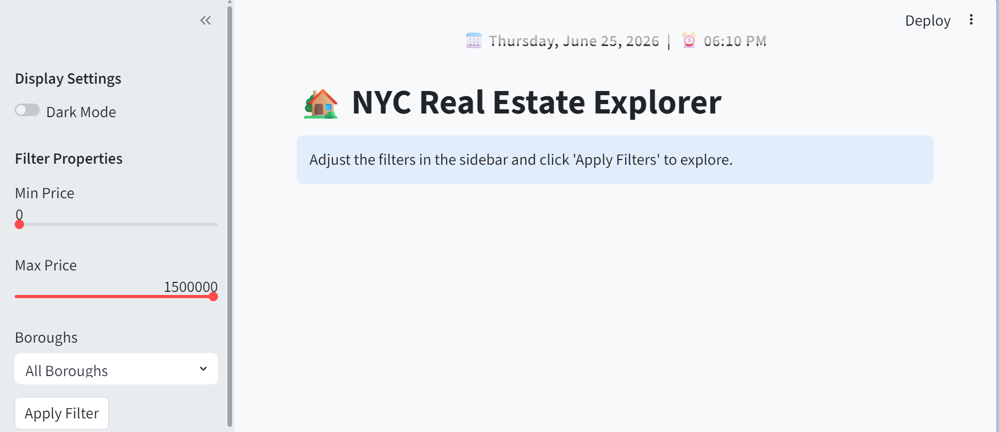
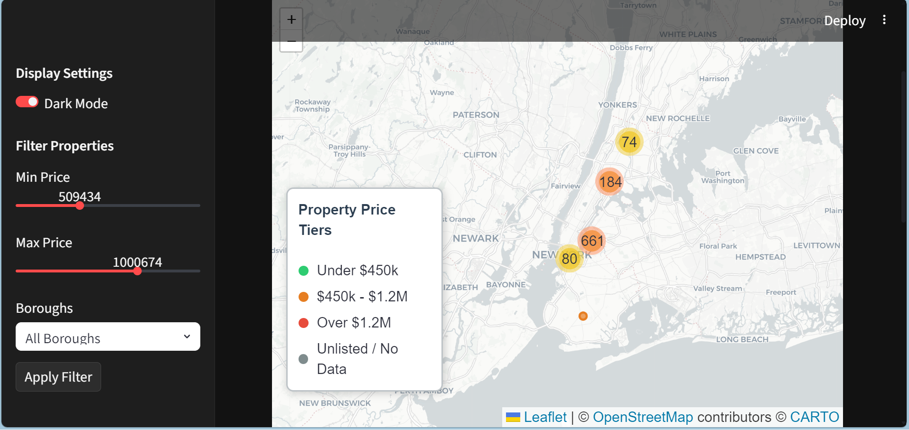
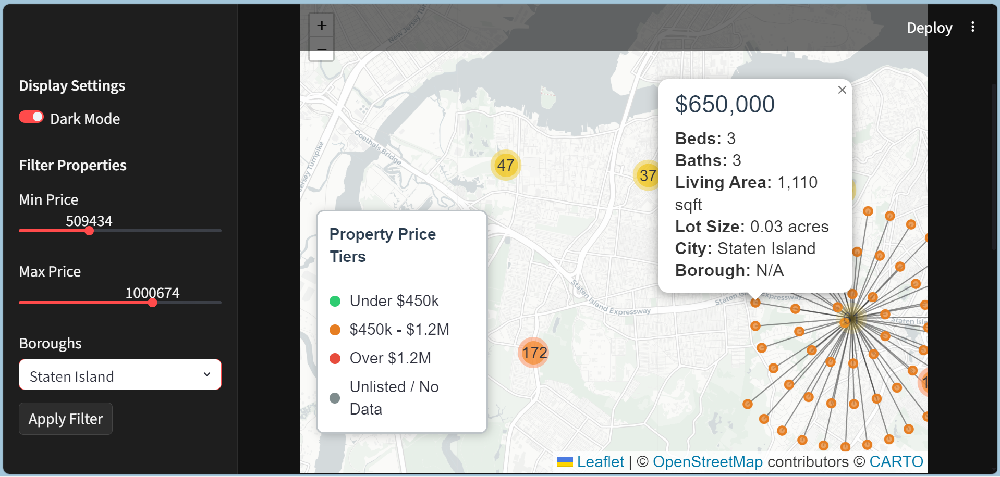

# 🏡 NYC Real Estate Explorer


[](https://scipy.org/)
[](https://python-visualization.github.io/folium/)
[](https://www.sqlalchemy.org/)

The NYC Real Estate Explorer is a high-performance web dashboard engineered to transform raw real estate datasets into actionable visual insights. It provides users with an interactive, responsive map interface to explore property listings across New York, filter by price points, and gain market insights through an integrated statistical cleaning pipeline.

---

## 📸 Screenshots
Light Mode

Dark Mode

Selection of properties in NYC between $500k and $1M

Advanced Analytics of property prices and house sizes in NYC

A property in Staten Island/Richmond


---

## 🚀 Key Features

- Interactive Geospatial Visualization: Powered by `Folium` and `Streamlit`, utilizing marker clustering to represent high-density real estate data clearly.

### Intelligent Data Science Pipeline:

- Automated Cleaning: Uses `Pandas` to sanitize input data and handle null values.

- Statistical Outlier Detection: Integrates a `SciPy` engine to calculate Z-scores, automatically filtering out extreme price anomalies that would otherwise distort map clustering.

### Performance Engineered:

- Dynamic Caching: Leverages @st.cache_data and @st.cache_resource for rapid state management and reduced load times.

- Render Optimization: Implements strict data capping (500 markers) to ensure the web browser remains responsive.

- User-Centric Interface: Features intuitive sidebar controls, visual price tier legends, and real-time feedback on search results.

---

## 📁 Project Structure
The project is architected for modularity and maintainability, cleanly separating the Data Layer, Analytics Engine, and Frontend Visualizer.

```python
nyc_real_estate_map_explorer/
├── app.py              # Main Application Orchestrator
├── requirements.txt    # Project dependencies
├── src/                # Source Code folder
│   ├── database.py     # SQLAlchemy Models & Data Retrieval
│   ├── create_nyc_csv.py # Create CSV file for the project
│   ├── peek.py         # Peek at the DB to see if it matches with USAProperty model
│   ├── ingest_data.py  # Initialise the DB 
│   ├── engine.py       # Pandas/SciPy Analysis & Outlier Detection
│   └── mapping.py      # Folium Map Generation & Cluster Logic
├── data/               # SQLite Databases & Source CSV files
├── assets/             # Logos, icons, and custom CSS
└── README.md           # Project Documentation
```

---

## 🚀 Getting Started
- Prerequisites
- Python 3.10 or higher.

- pip package manager.

### Installation
Clone the repository:

```Bash
git clone <your-repository-url>
cd nyc_real_estate_map_explorer
```
### Set up the Virtual Environment:

```Bash
python -m venv venv
source venv/bin/activate  # On Windows: venv\Scripts\activate
```
### Install Dependencies:

```Bash
pip install -r requirements.txt
```

### Launch the Application:

```Bash
streamlit run app.py
```

---

## ⚒️ Tech Stack
- Framework: `Streamlit`

- Geospatial: `Folium`, `Streamlit-Folium`

- Data Analysis: `Pandas`, `SciPy`

- ORM: `SQLAlchemy`

---

## 🔬Troubleshooting

Map not rendering? Verify that you are running the app in a modern browser with hardware acceleration enabled.

Data Missing? Ensure the data/ directory contains your source `CSV` or `SQLite` file.

Outlier Filtering? The `engine.py` pipeline uses a Z-score cutoff of 3. If you need to include extreme properties, you can adjust this threshold in `src/engine.py`.

---

## 🛣️ Roadmap Features

- [x] Update project with `Plotly` for deeper analysis of the property market.

- [x] Implement a multi-select dropdown in the sidebar to filter listings by specific NYC neighborhoods or boroughs.

- [ ] Create a secondary "Market Insights" tab using `st.tabs` to visualize data, such as average price per square foot or inventory distribution.

- [ ] Add a "Compare" button to property popups that allows users to "pin" listings to a session state list.

- [ ] Integrate a `st.download_button` that allows users to export the current filtered dataset into a `CSV` file.
Provides high-value offline utility, enabling users to move their research into `Excel` or `Google` Sheets for deeper personal analysis.

---

* **Built by Roy Peters** 🙂
[](https://www.linkedin.com/in/roy-p-74980b382/)
