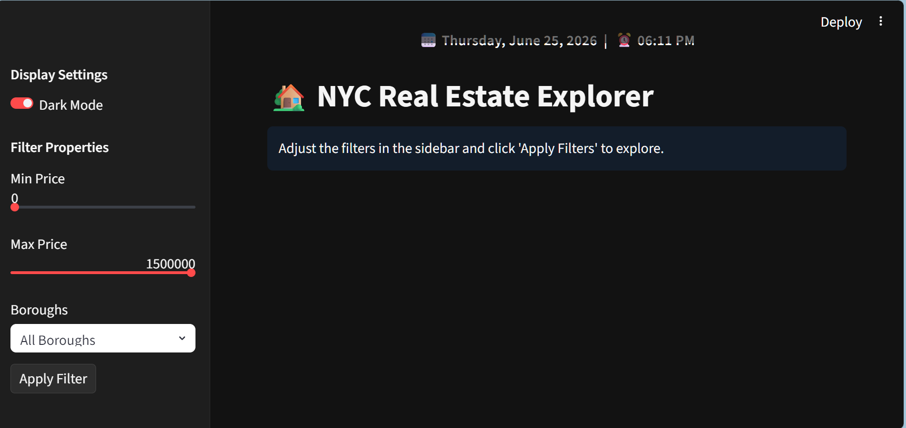
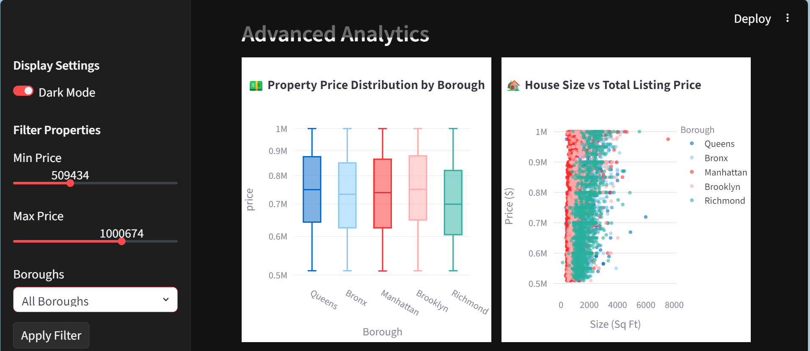

# 🏡 NYC Real Estate Explorer


[](https://python-visualization.github.io/folium/)


[](https://scipy.org/)

[](https://www.sqlalchemy.org/)


The NYC Real Estate Explorer is a high-performance web dashboard engineered to transform raw real estate datasets into actionable visual insights. It provides users with an interactive, responsive map interface to explore property listings across New York, filter by price points, and gain market insights through an integrated statistical cleaning pipeline.

---

## 📑 Table of Contents

- [Why Was This Project Built](#-why-was-this-project-built)
- [Screenshots](#-screenshots)
- [Key Features](#-key-features)
- [Project Structure](#-project-structure)
- [Getting Started](#-getting-started)
- [Launch The Application](#-launch-the-application)
- [Tech Stack](#-tech-stack)
- [Troubleshooting](#️-troubleshooting)
- [Testing](#-testing)
- [Roadmap Features](#️-roadmap-features)
- [Notes](#-notes)

---

## 🧠 Why Was This Project Built

### 🎯 Problem

- Large property datasets can be difficult to interpret using spreadsheets alone.
- Property locations, pricing trends, and neighbourhood patterns are often hidden within thousands of records.
- Extreme outlier values can distort analysis and visualisations.

### ✅ Solution

- Clean and process real estate data using Pandas and SciPy.
- Automatically detect and filter statistical outliers.
- Store and manage property records using SQLite and SQLAlchemy.
- Visualise listings through an interactive Folium map.
- Enable real-time filtering and exploration with a Streamlit dashboard.

---

## 📸 Screenshots

<p align="center">
  <strong>Property Search Dashboard</strong><br>

  Filter listings by price range and boroughs using the sidebar controls before generating an interactive
  
</p>

<p align="center">
  <strong>Property Search Dashboard Dark Mode</strong><br>
  
</p>

<p align="center">
  <strong>Interactive Property Map</strong><br>

  Explore New York property listings through an interactive Folium map featuring marker clustering, dynamic price filtering, and colour-coded property price tiers.
  
</p>

<p align="center">
  <strong>Advanced Market Analytics Dashboard</strong><br>

  Explore borough-level pricing trends with interactive box plots and analyze the relationship between house size and listing price using dynamic Plotly visualizations.
  
</p>

<p align="center">
  <strong>Interactive Property Detail View</strong><br>

  Select individual property markers to view detailed listing information, including price, bedrooms, bathrooms, living area, lot size, and location.
  
</p>

---

## 🚀 Key Features

- Interactive Folium property maps
- Marker clustering for high-density datasets
- Statistical outlier detection using SciPy
- Automated data cleaning with Pandas
- Dynamic Streamlit dashboard
- SQLite-backed property storage
- Real-time price filtering
- Cached data loading for improved performance
- Dark and light mode support

---

## 📁 Project Structure

```plaintext
nyc_real_estate_map_explorer/
├── assets/             # Logos, icons, and custom CSS
├── data/               # SQLite Databases & Source CSV files
├── screenshots/        # Screenshots of the Dashboard in action
├── src/                # Source Code folder
│   ├── database.py     # SQLAlchemy Models & Data Retrieval
│   ├── create_nyc_csv.py # Create CSV file for the project
│   ├── peek.py         # Peek at the DB to see if it matches with USAProperty model
│   ├── ingest_data.py  # Initialise the DB
│   ├── engine.py       # Pandas/SciPy Analysis & Outlier Detection
│   └── mapping.py      # Folium Map Generation & Cluster Logic
├── tests/              # Testing suite
├── app.py              # Main Application Orchestrator
├── CONTRIBUTING.md     # Contribute to project
├── LICENSE.md          # MIT License
├── pyproject.toml      # Project dependencies
└── README.md           # Project Documentation
```

---

## 🚀 Getting Started

### Prerequisites

- Python 3.11 or higher.
- uv package manager

### Installation:

- Clone the repository:

```Bash
git clone https://github.com/reory/nyc_real_estate_map_explorer.git
cd nyc_real_estate_map_explorer
```

### Set up the Virtual Environment:

```Bash
uv .venv python 3.11
# On Linux/macOS
source venv/bin/activate
# On Windows:
.venv/Scripts/activate 
```

### Install Dependencies:

```Bash
uv sync
```

---

## 🚀 Launch the Application:

```Bash
streamlit run app.py
```

Users can:
- Browse available property listings.
- Filter by price range.
- Explore different boroughs.
- View property details via map popups.
- Analyse market patterns through interactive visualisations

---

## 👨🏽‍💻 Tech Stack

### Streamlit 
- Interactive application framework. 

### Folium 
- Geospatial mapping and clustering.

### Pandas 
- Data cleaning and analysis. 

### SciPy 
- Statistical processing and outlier detection. 

### SQLAlchemy 
- Database abstraction and ORM management. ### SQLite Local data persistence layer.

---

## 🕵🏼‍♀️ Troubleshooting

Map not rendering? Verify that you are running the app in a modern browser with hardware acceleration enabled.

Data Missing? Ensure the data/ directory contains your source `CSV` or `SQLite` file.

Outlier Filtering? The `engine.py` pipeline uses a Z-score cutoff of 3. If you need to include extreme properties, you can adjust this threshold in `src/engine.py`.

---

## 🧪 Testing

This project uses **pytest** to validate core data processing, database operations, and analytical workflows.

```bash
pytest
```

---

## 🛣️ Roadmap Features

- [x] Update project with `Plotly` for deeper analysis of the property market.

- [x] Implement a multi-select dropdown in the sidebar to filter listings by specific NYC neighborhoods or boroughs.

- [ ] Create a secondary "Market Insights" tab using `st.tabs` to visualize data, such as average price per square foot or inventory distribution.

- [ ] Add a "Compare" button to property popups that allows users to "pin" listings to a session state list.

- [ ] Integrate a `st.download_button` that allows users to export the current filtered dataset into a `CSV` file.
Provides high-value offline utility, enabling users to move their research into `Excel` or `Google` Sheets for deeper personal analysis.

---

## 📝 Notes:

- CartoDB has been replaced by OpenStreetMap

---

* **Built by Roy Peters** 🙂
[](https://www.linkedin.com/in/roy-p-74980b382/)
